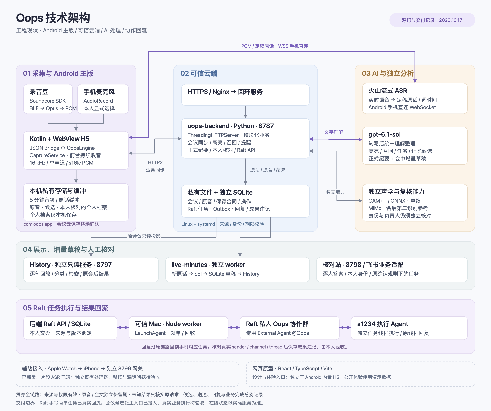

# Oops 技术架构

截至 2026-10-17，根据当前仓库源码与交付记录整理。主视图展示 Android 主版、可信云端、模型服务以及 Raft 协作的实际关系；本次未连接生产重新核验在线状态。

路演及非技术观众优先使用[分区架构总览](./oops-architecture-overview-20261017.md)：保留本图分区，以易读文字说明技术分工，并画清主后端、Raft API、任务数据库、Mac worker 与执行端的真实连接。其他表达版本：[六步流程与关键技术](./oops-architecture-pitch-20261017.md)、[通俗分工](./oops-architecture-simple-20261017.md)。

可编辑矢量图：[SVG](./oops-architecture-20261017.svg)；文本图源：[Mermaid](./oops-architecture-20261017.mmd)。SVG 是便于展示的概览，Mermaid 保留更细的组件关系。

## 核心链路

1. **采集与转写**：录音豆经 Soundcore SDK、Opus 解码得到 PCM；手机麦克风是另一条显式选择的音源。主版统一由 OopsEngine 与前台 CaptureService 承载，实时 PCM 由手机直接通过 WebSocket 送火山 ASR，接收定稿原话与词时间。
2. **理解与整理**：原话经 HTTPS 同步到 Python 主后端，现有主版的转写后理解统一使用私人配置的 `gpt-6.1-sol`，覆盖内容分类、高亮、召回、提醒、任务草稿、个人候选与正式纪要。模型候选保留短依据，进入人工核对。
3. **会中与会后**：独立 live-minutes worker 只处理授权范围内的新内容，写入来源绑定的草稿与调用账本。History 只读展示原会议、处理轨迹、分类、正式结果和增量草稿；会中草稿与正式纪要分开，查看页面不触发重新分析。20 秒为调度软目标，不是完成时限。
4. **保存与记忆**：正式会议按逐场确认的合同保存原音和全文，两者分别设置期限。手机个人档案为本人核对后的本机私有内容；会议／项目记忆读取原会话与已有结果，不复制成个人事实。
5. **任务与协作**：App 内核对沿用核对站逐人答案与本人飞书身份。显式交办后，Raft API 将来源与派工合同绑定到独立协作任务和 Outbox；可信 Mac 上的 worker 使用专用 @Oops 身份发到 Raft，a1234 在原线程回复，经核对后回到手机对应任务。本人决定业务完成。

## 技术栈与部署

| 层 | 当前实现 | 主要职责 |
|---|---|---|
| 采集端 | Soundcore SDK V1.3.02、Android AudioRecord、MediaCodec | 录音豆／麦克风、Opus 解码、统一 16 kHz 单声道 s16le PCM |
| Android 主版 | Kotlin、Coroutines、Android WebView、内置 HTML/CSS/JavaScript、JSON Bridge、OkHttp | UI、收音、环形缓冲、转写、业务同步、回听、上传、本人核对 |
| HTTPS 接入 | 公网 Nginx → 香港受限 TLS 入口 → 回环服务 | 鉴权透传、路由、请求体与连接限制 |
| 主后端 | Python 标准库 ThreadingHTTPServer、systemd，回环 `8787` | 会议／项目、原话、高亮、召回、纪要、声纹、飞书、Raft API |
| History | 独立 Python 只读服务，回环 `8797`；原生网页 JavaScript | 逐句回放、内容分类、检索、会中／会后展示、PPT 同屏 |
| 会中整理 | 独立 Python `oops-live-minutes` worker、SQLite | 增量调用 Sol、来源绑定草稿、调用账本、失败和未知暂停 |
| 核对站 | 独立 Python `oops-label`，回环 `8798` | 各人事项答案、版本、原话指纹；App 内核对通过原服务承接 |
| 智能处理 | 火山流式 ASR；私有 OpenAI-compatible Sol 接口；独立 CAM++／sherpa-onnx；MiMo 第二识别 | ASR 与语义理解分离；声纹单独授权与校准；MiMo 只给会后纪要参考 |
| 协作 worker | 可信开发 Mac、Node SDK、LaunchAgent | 从后端领单、真实 Raft 发送、回执核实、原线程回复回收 |
| 外部业务 | 飞书、Raft 私人 Oops 协作群、a1234 Agent | 本人身份、原确认规则下的任务／纪要、显式交办与执行回复 |
| 网页原型 | React 19、TypeScript、Vite | 设计与交互预览；与 Android 内置 H5 是两条界面实现线 |
| Apple 辅助接入 | Swift、WatchConnectivity、独立 Python 移动网关 `8799` | Watch → iPhone → 受限网关 → 分段 ASR／原会议后端 |

主后端按模块组织业务并在一个服务进程中运行；History、核对站、会中整理 worker 和 Apple 网关具有独立运行边界。图不表示所有业务模块均拆成独立服务。

## 数据保存位置

| 数据 | 保存位置与形式 | 边界 |
|---|---|---|
| 手机音频、原话、片段、待核对候选 | App 私有 PCM、JSON、JSONL 文件；5 分钟环形缓冲 | 临时缓冲与明确保存分开；文字同步和原音归档是独立状态 |
| 个人记忆 | Android `noBackupFilesDir`，AtomicFile | 仅本机；本人核对、修改或舍弃；尚未接个人档案云同步或模型检索 |
| 会议与已有结果 | 后端私有 `meetings/`、`boards/` 等文件 | 同一原会议对象及其来源合同；项目当前仍按名称关联 |
| 原音与归档 | 后端 `recordings/`，PCM／JSONL／manifest／complete | 分块续传与 SHA-256；本机上传完成和云归档状态分别记录 |
| 保存合同 | 后端 `archive-policies/` | 原音／全文分别为本人所选 7／30／90 天；重试不续期 |
| 飞书操作 | `operations/`、`feishu/state.json` | 冻结确认版本、请求编号、业务回执；与 Raft 协作任务独立 |
| 事项核对答案 | 核对站原逐人答案 JSON | App 只承接经过验证的本人答案，保留其他人的答案与分歧 |
| Raft 协作 | `raft/outbox.sqlite3`、`collaboration.sqlite3`、`collaboration-tasks.sqlite3` | 分别记录发送与回复、群及交接、来源任务与成果注记 |
| History 派生数据 | 独立访问 SQLite、来源绑定复核侧车、`live-minutes.sqlite3` | 原会议只读；派生副本继承来源保护；调用账本与正文分开 |
| Apple 网关 | 独立 SQLite、受限临时 PCM | grant、请求及 ASR job 绑定；不成为另一套主会议库 |

## 交付状态与边界

| 能力 | 记录中的实际状态 |
|---|---|
| Android 主版、Sol 主链、会议／原音保存、History | 有生产部署与真机交付记录；录音豆冷启及反复重连稳定性仍有单独验收限制 |
| 会中增量草稿 | 常驻 worker 已部署，当前 `compact-v1 / delta-v3-compact`；草稿须核对，20 秒不作固定延迟承诺 |
| Raft 手写简单任务 | 已完成手机发送 → a1234 回复 → 手机对应任务读取与成果注记的真实连通 |
| 真实会议候选 → Raft | 后端及手机入口已接入、本人来源读取已通；未发送真实会议业务任务，执行闭环待验收 |
| 个人记忆自动提取 | 链路已部署并安装；既有泛高亮与新协议候选分开，真实新协议提取／本人确认质量未验收 |
| Apple Watch／iPhone | 已部署并安装，有单片段 ASR 联通；整场、后台稳定性和段内漏话问题未完成验收。当前独立网关文档仍记载既有 Jev 处理，不据 Android 的 Sol 统一状态推定 Apple 已迁移 |
| React 原型／画板 | 独立预览；公开体验使用演示数据。本机私人预览可显式接本机服务，不能当作主版安装状态 |
| 声纹与长会分段 | 声纹归属门禁独立；严格分段／长会分段未按图默认启用 |

## 跨层约束

- **来源贯穿结果**：原句 ID、正文指纹、音频时间、本人身份、核对版本和保存合同绑定到候选、任务、派工及结果；修订、删除、撤权或到期会阻止旧正文和旧许可复活。自然全文到期可按原规则保留本人独立确认的摘要、任务及必要短证据。
- **授权按动作区分**：开始收音、正式会议云保存、本人事实确认、核对答案保存、派工、飞书任务创建及业务完成分别承接；模型建议或发送回执不代替本人确认。
- **未知结果不重发**：付费模型、Raft 发送与外部写操作保留请求账本；结果未知只核实原请求，避免以新编号重复收费或重复根消息。
- **凭据留在受信范围**：模型与 Raft／worker 全权限凭据只在可信服务或 Mac；APK／H5 不持有这些凭据。Android ASR 鉴权与 Apple 移动 grant 按各自接入范围处理。
- **派生不绕过原来源**：History、实时草稿与协作回复遵守来源失效清理；读取页面不启动额外模型／ASR请求。

## 源码与记录依据

路径相对仓库根目录。

| 范围 | 依据 |
|---|---|
| 安卓运行与桥接 | [MainActivity.kt](../../android/app/src/main/java/com/oops/app/MainActivity.kt)、[OopsEngine.kt](../../android/app/src/main/java/com/oops/app/engine/OopsEngine.kt)、[CaptureService.kt](../../android/app/src/main/java/com/oops/app/service/CaptureService.kt)、[WebBridge.kt](../../android/app/src/main/java/com/oops/app/bridge/WebBridge.kt) |
| 录音豆与 ASR | [SoundcoreBeanLink.kt](../../android/app/src/soundcore/java/com/oops/app/audio/SoundcoreBeanLink.kt)、[VolcAsrClient.kt](../../android/app/src/main/java/com/oops/app/asr/VolcAsrClient.kt)、[录音豆交付](../bean-app-autostart-20261016.md)、[恢复边界](../bean-reconnect-handoff-20261016.md) |
| 原生存储 | [SessionRecorder.kt](../../android/app/src/main/java/com/oops/app/store/SessionRecorder.kt)、[RecordingUploader.kt](../../android/app/src/main/java/com/oops/app/store/RecordingUploader.kt)、[PersonalMemoryStore.kt](../../android/app/src/main/java/com/oops/app/store/PersonalMemoryStore.kt) |
| 后端与模型 | [local_backend.py](../../scripts/local_backend.py)、[sol_text.py](../../scripts/sol_text.py)、[minutes_model.py](../../scripts/minutes_model.py)、[Sol 部署](../sol-text-rollout-20261016.md) |
| 保存与清理 | [recordings.py](../../scripts/recordings.py)、[archive_policy.py](../../scripts/archive_policy.py)、[三项后端修复](../backend-three-fixes-20261016.md) |
| History／会中草稿 | [replay_history.py](../../scripts/replay_history.py)、[live_minutes.py](../../scripts/live_minutes.py)、[最新增量配置](../live-speed-and-empty-draft-20261017.md)、[History 复核交付](../history-judgment-20261017.md) |
| 核对与飞书 | [app_task_reviews.py](../../scripts/app_task_reviews.py)、[feishu_actions.py](../../scripts/feishu_actions.py)、[App 内核对](../task-review-in-app-20261016.md) |
| Raft | [raft_api.py](../../scripts/raft_api.py)、[worker README](../../scripts/raft-bridge/README.md)、[真实手机回流](../raft-mobile-production-20261017.md)、[会议候选入口](../raft-direct-task-20261017.md) |
| 个人记忆 | [自动候选交付](../personal-memory-auto-20261017.md)、[既有候选承接](../memory-personal-task-read-20261017.md) |
| 独立部署 | [主后端 service](../../deploy/oops-backend.service)、[History service](../../deploy/oops-history.service)、[实时 worker service](../../deploy/oops-live-minutes.service)、[核对站 service](../../deploy/oops-label.service) |
| 辅助与原型 | [Apple 网关](../apple-mobile-gateway.md)、[Apple ASR](../apple-backend-asr-20261016.md)、[Apple 漏话边界](../apple-recording-missing-speech-20261016.md)、[React 协作边界](../raft-collaboration-20261017.md)、[package.json](../../package.json) |

本次只新增架构文档与图件，做必要的文件、图面及引用静态核对；未运行测试或构建，未修改业务代码、部署、操作手机或发起模型／ASR／Raft 请求。
