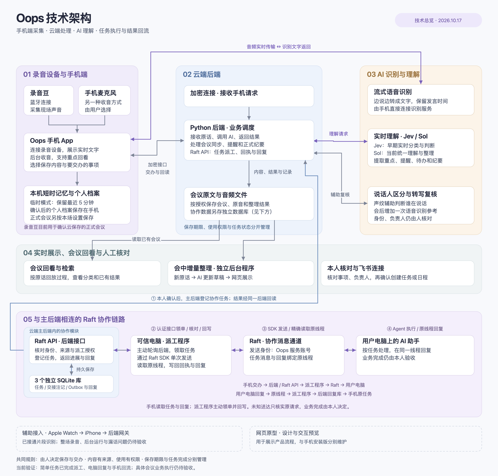

# Oops 技术架构总览

沿用最初工程架构图的分区布局，以中文职责说明减少内部术语。保留手机端、云端后端、AI 识别与理解、展示与核对、Raft 派工与结果回流五个区域；Raft 区已按实际实现接回主后端，并明确接口、数据库、可信电脑上的派工程序、Raft 服务和用户电脑的关系。

[高清 PNG](./oops-architecture-overview-20261017.png) · [可编辑 SVG](./oops-architecture-overview-20261017.svg) · [工程细节与来源依据](./oops-architecture-20261017.md)

图中保留 Python 后端、流式语音识别、Jev／Sol 实时理解、任务数据库、派工程序、Raft 协作通道等架构概念；将协议缩写、编程接口、端口号、内部模块名与音频格式换成对应的中文职责说明。设备与账号使用“可信电脑”“用户电脑”“Oops 服务账号”等角色名称，实际连接与权限校验仍沿用现有实现。

用户明确希望在介绍实时能力时体现 Jev。AI 区域现标注“Jev：早期实时分类与判断”和“Sol：当前统一理解与整理”，用于说明这一路径的技术演进，不表示当前安卓主版两者同时处理或自动互相回退。语音识别仍是独立链路。

手机直接连接语音识别服务，识别后的原话进入后端；后端调用 Sol 并保存结果。本人明确交办后，主后端内的 Raft API 持久登记任务与发送队列，可信电脑上的派工程序通过认证接口主动领取，经 Raft SDK 送达用户电脑。执行回复写回后端，手机再读取对应任务；是否完成由本人验收。

## Raft 如何接入主系统

1. **App → 主后端**：Android 的 `RaftClient` 经认证 HTTPS 调用同一 Python 主后端的 `/v1/raft/*`。真实来源交办保留本人身份、来源版本和当次确认；App 读取任务、进展与回复也走这套后端接口。
2. **主后端内 Raft API → 独立持久化**：`RaftApi` 与主后端处于同一服务，使用三个独立 SQLite 库保存协作任务、群与交接／注记、发送队列与回执／回复。会议原文和音频仍保留原文件存储。图中的下方蓝框是上方 Python 后端协作模块的展开。
3. **派工程序（可信电脑）→ 后端接口**：现有后台进程使用独立 worker 认证；通过 `poll` 主动领单，通过 `validate` 核对当前许可，再以 `settle`、`replies` 写回真实回执和回复。任务通过接口返回，派工程序不直接打开服务器 SQLite。具体运行环境见工程说明。
4. **派工程序 → Raft → 用户电脑**：派工程序在可信电脑上调用官方 Raft SDK，使用专用 Oops 服务账号，将任务消息发到已核对的私人协作群，再由用户电脑上已连接的 AI 助手处理。Raft 是这条链中的通信通道，实际任务处理发生在用户电脑。
5. **执行电脑 → 原线程 → worker → 后端**：执行回复留在同一原任务线程；worker 只读取确切线程，核对实际发送人、群与线程身份，然后写回后端回复库及对应任务关联。
6. **后端 → App 原任务**：手机经原任务接口读取状态与回复；成果注记由人核对，业务是否完成仍由本人决定。本次没有将手机推送、云端主动推单或任意回复执行为新指令画成现有能力。

来源依据：[worker 实现与接口约定](../../scripts/raft-bridge/README.md)、[主后端 Raft API](../../scripts/raft_api.py)、[Android RaftClient](../../android/app/src/main/java/com/oops/app/backend/RaftClient.kt)、[生产与手机真实回流](../raft-mobile-production-20261017.md)、[当前会议交办入口](../raft-direct-task-20261017.md)。

约 25 秒口播：录音豆收音、手机流式转写，后端持续理解对话。早期用 Jev 做实时分类判断，目前由 Sol 统一整理重点和待办。用户确认后，再通过 Raft 交给电脑执行，结果回到原任务，让 AI 在后台接住对话和行动。

原图的实际能力和交付边界保持：日常临时缓存与正式会议归档分开；录音豆当前仅支持确认云保存的正式会议；AI 提醒和草稿需要核对。简单任务派工与回复已真实回流，具体会议业务执行仍待验收；Apple 辅助接入和网页原型单独展示。来源依据、权限、保存期限和未完成能力以工程说明为准。

本次仅更新图文与文档入口，依据当前源码和既有交付记录补齐 Raft 连接；已做图面、引用与连接静态核对，未运行测试或构建，未修改业务代码、访问生产或发送任务。
