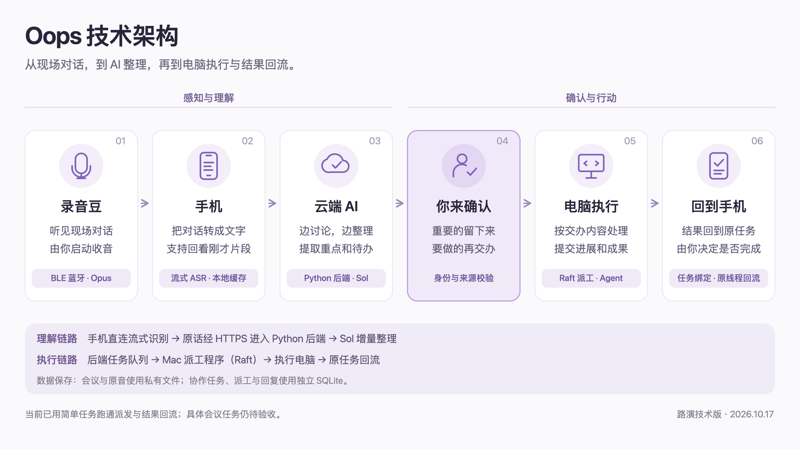

# Oops 技术架构 · 路演版

采用六步流程说明设备分工，在每一步下保留一行关键技术，并补充理解和执行的连接方式。画面比例为 16:9。

[高清 PNG](./oops-architecture-pitch-20261017.png) · [可编辑 SVG](./oops-architecture-pitch-20261017.svg) · [工程架构与依据](./oops-architecture-20261017.md)

## 约 25 秒口播

录音豆通过蓝牙收音，手机完成流式转写，后端用 Sol 持续整理重点和待办。用户确认后，任务进入队列，通过 Raft 派给电脑上的 Agent 执行，结果回到手机原任务。让 AI 在后台衔接理解和行动，关键决定留给人。

## 图中保留的技术

| 分工 | 关键技术及其作用 |
|---|---|
| 录音豆听见现场 | BLE 蓝牙与 Opus 音频：连接设备并传输采集到的声音 |
| 手机承接转写与回看 | 流式 ASR 与本地缓存：音频边传边识别，保留可回看的近期内容。实际识别由手机直连云端 ASR 承担 |
| 云端理解对话 | 原话经 HTTPS 接入 Python 后端，由 Sol 进行理解与增量整理 |
| 本人确认 | 身份、来源与版本校验：确认内容和交办范围，保留出处与当前版本 |
| 电脑执行 | 后端持久任务队列，由可信 Mac 的派工程序通过 Raft 交给执行 Agent |
| 结果返回手机 | 任务绑定与原线程回流：核对真实回复来源后写回对应任务，由本人验收 |

会议与原音按原保存合同使用私有文件；Raft 协作任务、派工和回复使用后端独立 SQLite。图中没有将 SQLite 放到 Android 端。

## 范围与交付边界

后台实时 ASR、逐句理解、会中增量草稿和正式会后纪要具有各自的处理时机，图中的“边讨论边整理”不承诺固定完成延迟。

本人开始收音、会议云保存、内容核对与派工确认分别承接。“你来确认”是对这些人工决定的合并展示，不将一次派工确认解释成原事项已完成核对。已允许显式交办的候选仍保持其真实核对状态。

日常五分钟短时缓存与正式会议归档是不同模式，当前录音豆只开放逐场确认云保存的正式会议。手机承接的转写依赖云端识别，不表示全部音频处理只在本地完成。

简单任务派发、a1234 执行回复和手机对应任务回流已有真实连通记录；具体会议业务执行仍待验收。图中不宣称行动结果已经自动进入下一次对话上下文。其他来源与能力边界沿用工程架构说明。

本次只更新架构图与说明，已做图面和文件静态核对；未运行测试或构建，未修改业务代码、操作手机或生产环境。
