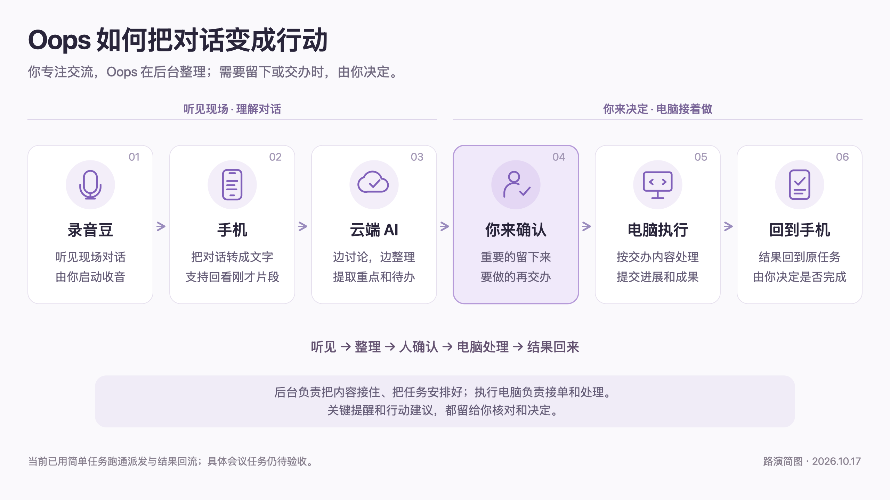

# Oops 如何把对话变成行动

路演简版，适合没有技术背景的观众；画面为 16:9。

[高清 PNG](./oops-architecture-simple-20261017.png) · [可编辑 SVG](./oops-architecture-simple-20261017.svg) · [工程架构与交付依据](./oops-architecture-20261017.md)

## 约 25 秒口播

Oops 的工作方式很简单：录音豆听见对话，手机把话变成文字，也能找回刚才的重要片段。云端 AI 边讨论边整理重点和待办。你确认后，任务交给连接的电脑处理，结果再回到手机。让你专注交流，只在关键处做决定。

## 图中的分工

- 录音豆：用户启动后，采集现场声音。
- 手机：串联语音转文字、短时回看、内容核对和任务查看。
- 云端 AI：后端接收原话，调用实时理解与增量整理能力，形成有原话依据的重点和待办建议。
- 你来确认：本人决定什么要保留、什么要交办；派工确认与原事项核对状态分别保存。
- 电脑执行：云端接收派工并排队，可信 Mac 上的 worker 经 Raft 转给已连接的执行电脑助手；云端服务与实际执行电脑职责分开。
- 回到手机：执行回复回到对应任务，保留进展和成果，业务是否完成由本人决定。

## 表达边界

简图描述当前组件之间的分工。简单任务的派发、执行回复和手机回流已有真实连通记录；具体会议业务执行仍待验收。

“把话变成文字”是手机承接的功能，实际实时识别依赖云端 ASR；主版的文字理解已统一到 Sol。口播省略模型名、编程语言、协议、端口与数据库名称。

“找回刚才片段”仍受可用原话与录音范围约束。日常五分钟缓冲与正式会议归档是不同模式；当前录音豆仅支持逐场明确确认云保存的正式会议，不能将简图解释为录音豆已支持全天日常短时聆听。提醒和内容提取的质量仍需分别验收。

图中没有将执行结果自动写成下一次对话上下文；自动 Learn 尚未形成完整闭环。

本次只新增路演图和说明，做图面与文件静态核对；未运行测试或构建，未修改业务代码或生产环境。
